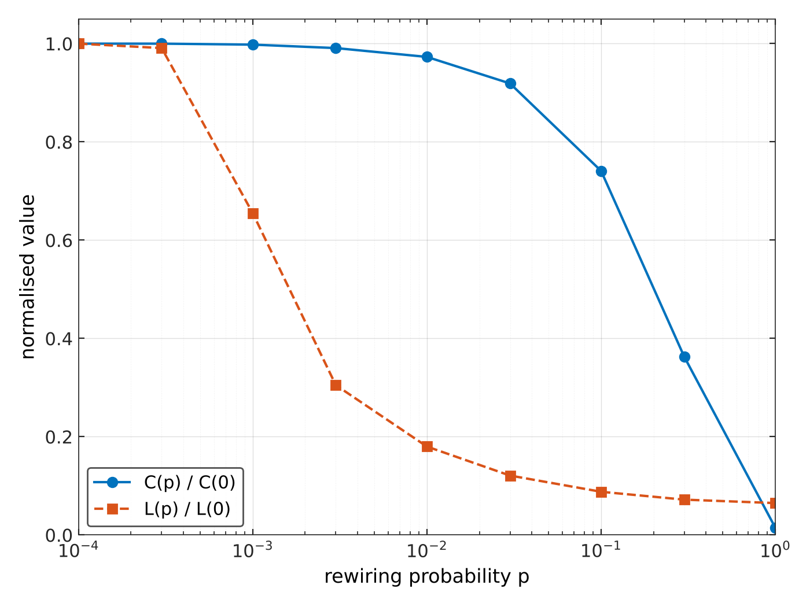
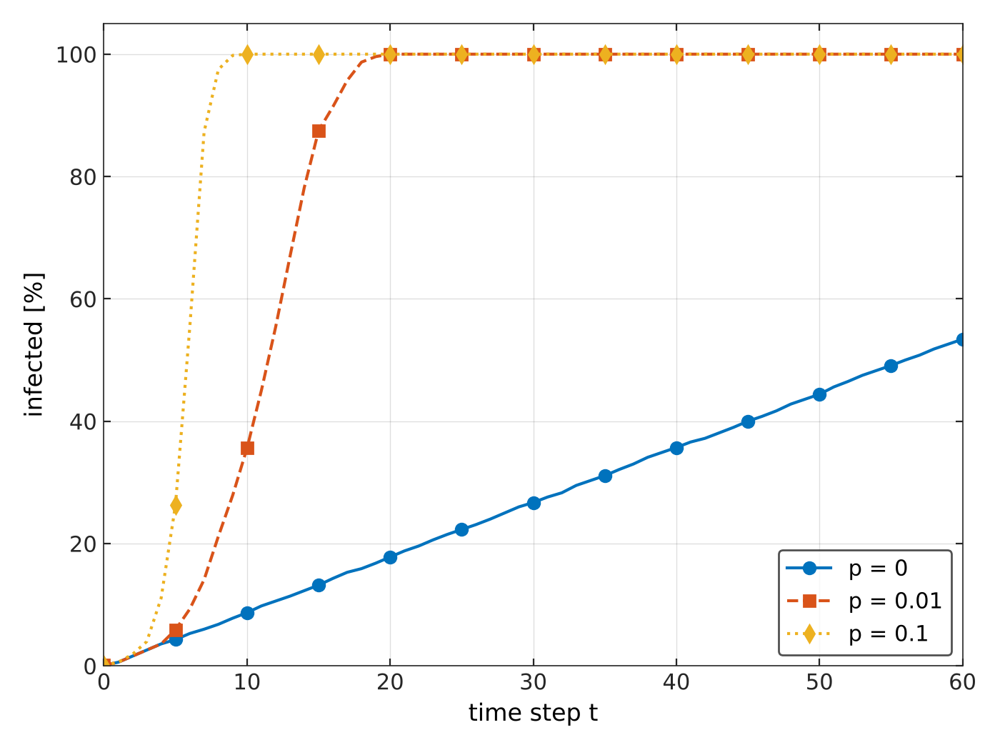
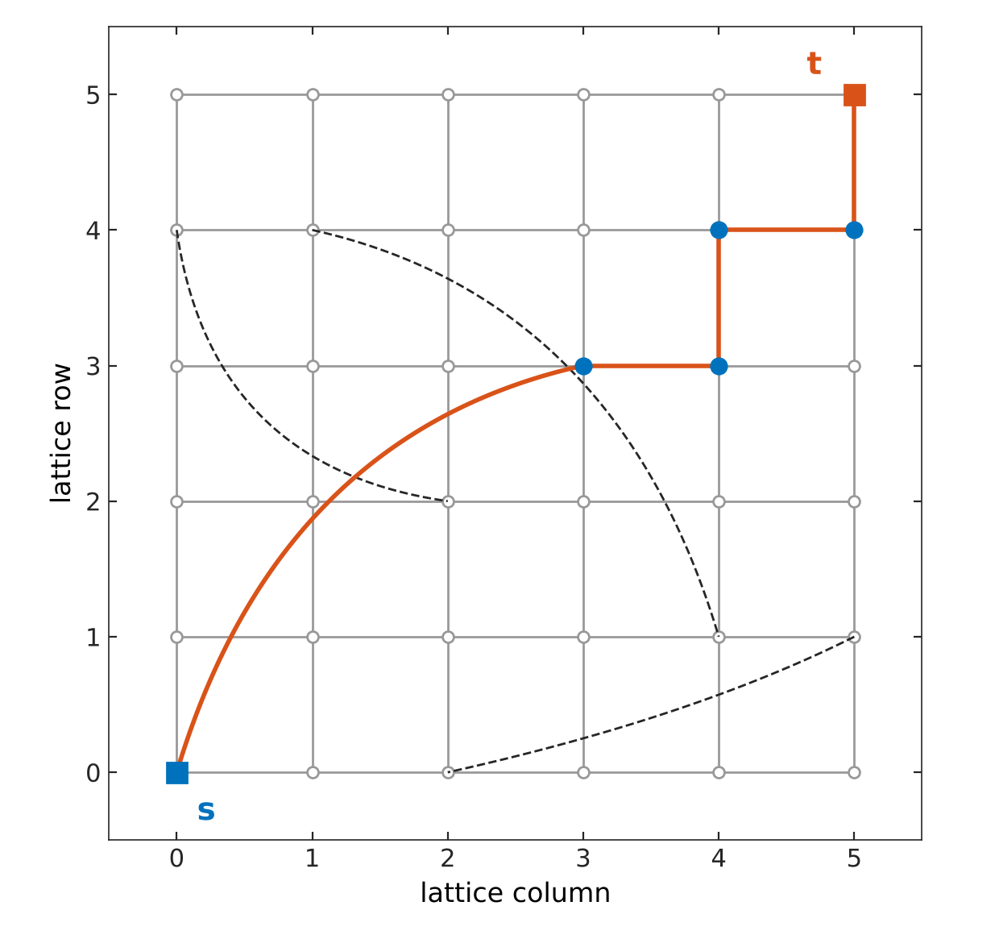
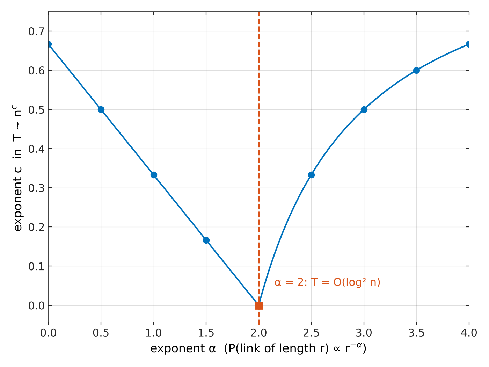
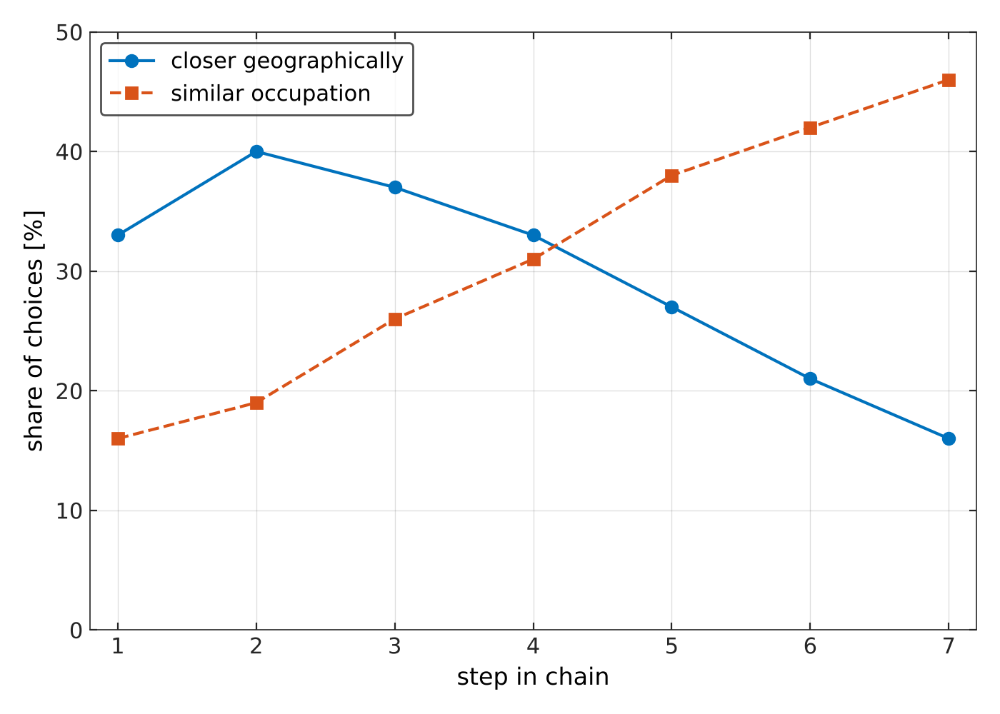

# Small-World Networks: Simulations

Simulations and figures for a talk on **small-world networks** (course *Graphs and Their Applications*, AGH University of Krakow). The repository covers the Watts–Strogatz model, Kleinberg's navigability result, epidemic spreading on small worlds, and data from the global e-mail search experiment. Each part is implemented in **Python** (simulations + plots) and **MATLAB** (plots).

<p align="center">
  
  
</p>

## What is a small world?

A network is a *small world* when it has, at the same time:

- **high clustering** `C`: your neighbours tend to know each other,
  `C_v = 2 e_v / (k_v (k_v - 1))`, `C = mean(C_v)`;
- **short paths** `L`: the average shortest-path distance grows only like `ln N`,
  `L = 2 / (N (N - 1)) * Σ_{i<j} d(i, j)`.

A regular ring lattice has high `C` but long paths (`L ≈ N / 2K`). A random graph has short paths (`L ≈ ln N / ln K`) but almost no clustering (`C ≈ K / N`). Watts and Strogatz (1998) showed that rewiring just a few edges of a lattice gives both properties at once.

## Repository structure

```
├── python/
│   ├── watts_strogatz.py      # WS model from scratch + C and L (BFS), no dependencies
│   ├── ws_simulation.py       # C(p)/C(0) and L(p)/L(0) sweep with NetworkX
│   ├── epidemic_si.py         # SI epidemic on WS networks for p = 0, 0.01, 0.1
│   ├── plots.py               # all figures in MATLAB style -> figures/
│   └── requirements.txt
├── matlab/
│   ├── ws_clustering_path_length.m   # C(p)/C(0), L(p)/L(0), log-scale p
│   ├── kleinberg_grid.m              # lattice + long-range links + greedy path
│   ├── kleinberg_phase_transition.m  # greedy routing exponent vs alpha
│   ├── si_epidemic.m                 # infected share over time
│   └── greedy_search_dodds.m         # geography vs occupation per chain step
└── figures/                   # generated PNGs
```

## Quick start

### Python

```bash
cd python
pip install -r requirements.txt

python watts_strogatz.py   # sanity check of the from-scratch implementation
python ws_simulation.py    # ~1–2 min, writes results/ws_curves.csv
python epidemic_si.py      # writes results/epidemic_si.csv
python plots.py            # writes all figures to ../figures/
```

`plots.py` uses the CSV files from `results/` when they exist and falls back to the values from the original run otherwise.

### MATLAB

Open any script in `matlab/` and run it. Each one is self-contained (data are embedded) and produces one labelled figure.

## Results

### 1. Watts–Strogatz: path length collapses before clustering

`N = 1000`, `K = 10`, mean of 3 realisations.

| p | C(p)/C(0) | L(p)/L(0) |
|---|---|---|
| 0.001 | 0.998 | 0.655 |
| 0.01 | 0.973 | 0.180 |
| 0.1 | 0.741 | 0.088 |
| 1 | 0.015 | 0.065 |

At `p = 0.01` the network keeps 97% of its clustering while paths are already 5× shorter (50.5 → 9.1 steps). The Barrat–Weigt approximation `C(p) ≈ C(0)(1 − p)^3` matches the simulation closely (0.729 vs 0.741 at `p = 0.1`).

### 2. Kleinberg: shortcuts must have the right length distribution

<p align="center">
  
  
</p>

On an `n × n` lattice where each node gets one long-range link of length `r` with probability `∝ r^(−α)`, greedy routing (forward to the neighbour closest to the target) needs `T ~ n^c` steps:

- `α < 2`: `c = (2 − α) / 3`
- `α > 2`: `c = (α − 2) / (α − 1)`
- `α = 2`: `T = O(log² n)`, the only navigable case.

Short paths existing (Watts–Strogatz, `α = 0`) is not the same as being able to find them with local information.

### 3. Epidemics spread much faster on small worlds

SI model, `N = 1000`, `K = 10`, infection probability 0.5 per step. Steps until half of the network is infected:

| p = 0 (lattice) | p = 0.01 | p = 0.1 |
|---|---|---|
| 56 | 12 | 6 |

### 4. Greedy search in a real social network

<p align="center">
  
</p>

Data from Dodds, Muhamad & Watts (2003), Table 2: why senders chose the next person in the chain. Early in a chain people mostly use **geography** (blue); from step 4–5 on, **occupation** (orange) dominates. This is greedy routing in practice.

## References

- Milgram, S. (1967). The small world problem. *Psychology Today*, 2, 60–67.
- Travers, J., & Milgram, S. (1969). An experimental study of the small world problem. *Sociometry*, 32, 425–443.
- Granovetter, M. S. (1973). The strength of weak ties. *American Journal of Sociology*, 78, 1360–1380.
- Watts, D. J., & Strogatz, S. H. (1998). Collective dynamics of 'small-world' networks. *Nature*, 393, 440–442.
- Newman, M. E. J., & Watts, D. J. (1999). Scaling and percolation in the small-world network model. *Physical Review E*, 60.
- Barrat, A., & Weigt, M. (2000). On the properties of small-world network models. *European Physical Journal B*, 13.
- Kleinberg, J. (2000). Navigation in a small world. *Nature*, 406, 845; The small-world phenomenon: an algorithmic perspective. *STOC 2000*.
- Dodds, P. S., Muhamad, R., & Watts, D. J. (2003). An experimental study of search in global social networks. *Science*, 301, 827–829.
- Humphries, M. D., & Gurney, K. (2008). Network 'small-world-ness'. *PLoS ONE*, 3.
- Telesford, Q. K., et al. (2011). The ubiquity of small-world networks. *Brain Connectivity*, 1.
- Malkov, Y. A., & Yashunin, D. A. (2018). Efficient and robust approximate nearest neighbor search using HNSW graphs. *IEEE TPAMI*, 42.

## License

MIT, see [LICENSE](LICENSE).
